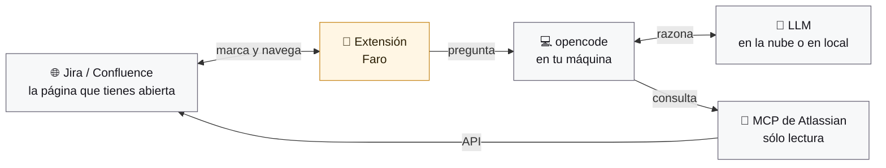

# Faro

Extensión de Chrome que convierte tu **opencode local** en un copiloto dentro
de Jira y Confluence — y que, además de responder, **te lleva hasta donde está
la respuesta**.

- Chat en un panel lateral, con el modelo que tú elijas de los que ya tiene tu
  opencode (aquí, 43 entre tres proveedores).
- Consulta Jira y Confluence de verdad, a través del servidor MCP
  `mcp-atlassian`. Faro te prepara el bloque de configuración y espera a
  detectarlo; las claves van a tu opencode, no al navegador.
- Un mapa del sitio construido la primera vez —**incluido el árbol de páginas
  completo**, que es lo que permite enseñarte el camino— y que se enriquece con
  el uso.
- Memoria dentro de la sesión, y opcionalmente entre sesiones.
- Un **registro** de todo lo que se le pide a opencode, con resultado y
  duración, para saber qué pasó cuando algo falla.
- **Navegación asistida**: va **desplegando el árbol de páginas de la
  izquierda**, rama a rama, hasta dejar el destino a la vista. Sólo entonces
  navega — una vez, no ocho — y al llegar marca el párrafo exacto del que te
  hablaba. El camino no se lo inventa el modelo: es la rama del árbol. Y al
  llegar no oscurece nada: subraya.
- **Dos formas de señalar**: el foco de siempre, que oscurece el resto de la
  página, o un **subrayado amarillo** que no tapa nada y rodea las imágenes con
  un filete muy fino. Se elige en Ajustes.
- **Señalar tú**: un botón en la barra de abajo cambia el cursor y te deja
  subrayar un párrafo o pulsar una imagen. Eso —y sólo eso— es el contexto de la
  siguiente pregunta. La imagen viaja de verdad, no su `alt`.
- **Skills**: General, Búsqueda, Resumen y Análisis, junto al selector de modelo.
  Las dos primeras te llevan; las otras dos trabajan sobre lo que tienes delante
  y no ofrecen viaje.
- **Análisis con marcas numeradas**: el modo Análisis numera sus observaciones y
  **subraya en la página el pasaje del que habla cada una**, con su número
  detrás, como una nota al pie. En el chat, pulsar un `[2]` te lleva a su
  subrayado; pulsar el número en la página te lleva a su fila en el chat.

---

## Requisitos

| Qué | Por qué | Comprobado |
|---|---|---|
| `opencode` ≥ 1.2 | Es el motor. La extensión no habla con ninguna nube. | 1.2.25 |
| Chrome ≥ 116 | `chrome.sidePanel` y la CSS Custom Highlight API. | |
| `uvx` (o Docker) | Para ejecutar `mcp-atlassian`. | uvx en Windows |
| Un API token de Atlassian | Para leer Jira y Confluence. | |

---

## Instalación

### 1. Carga la extensión

```bash
chrome://extensions → Modo desarrollador → Cargar descomprimida → esta carpeta
```

El identificador es fijo (viene del campo `key` del manifest), así que no
cambia entre recargas ni entre equipos:

```
ickohiffpicdfeameogbihbcanbjibmk
```

### 2. Arranca opencode con CORS y contraseña

```bash
opencode serve --port 4096 --cors chrome-extension://ickohiffpicdfeameogbihbcanbjibmk --print-logs --log-level INFO
```

La bandera `--cors` lleva ese identificador porque Chrome, si no, bloquea la
lectura de las respuestas. Y `--print-logs --log-level INFO` hace que la
terminal muestre lo que esta pasando dentro de opencode:

```
INFO service=server status=completed duration=1 method=GET path=/global/health
INFO service=server status=started method=POST path=/session/ses_.../prompt_async
INFO service=config path=C:\\Users\\marco\\.config\\opencode\\opencode.json loading
```

Ahi se ven las llamadas, los tiempos, que configuracion carga y cualquier
error del lado del servidor. El **registro del panel** ensena lo mismo desde
el otro lado; los dos juntos cubren el camino entero. Para poner contraseña —recomendado, porque si no
cualquier proceso local puede pedirle cosas a opencode— define
`OPENCODE_SERVER_PASSWORD` antes de arrancar y méte la misma en los ajustes del
panel.

En PowerShell:

```powershell
$env:OPENCODE_SERVER_PASSWORD = "algo-largo-y-tuyo"; opencode serve --port 4096 --cors chrome-extension://ickohiffpicdfeameogbihbcanbjibmk --print-logs --log-level INFO
```

### 3. Abre Jira o Confluence y pulsa el icono

La primera vez en cada sitio, Faro te pedirá el correo y el API token
(`id.atlassian.com` → Security → API tokens).

Después te enseñará un bloque de configuración para pegar en el `opencode.json`
de tu opencode, y te pedirá reiniciarlo. **Esto es una vez por sitio**, y es
inevitable: opencode 1.2.25 sólo carga los servidores MCP al arrancar, y su
endpoint para registrarlos en caliente responde `200` sin hacer nada. Faro se
queda vigilando y, en cuanto detecta el MCP conectado, sigue solo.

Luego te ofrecerá construir el contexto, traer el tuyo, o empezar sin él.

Los detalles están en [`docs/INSTALL.md`](docs/INSTALL.md).

---

## Cómo funciona



Cinco piezas y ningún misterio:

- **La extensión** es la única que toca la página. Lee lo que estás viendo, va
  desplegando el árbol de la izquierda y marca en amarillo el fragmento del que
  te habla, sin modificar el documento.
- **opencode** corre en tu máquina. La extensión no habla con nadie más: sólo
  con `127.0.0.1`.
- **El LLM** lo eliges tú de la lista que tenga tu opencode: uno de pago en la
  nube, uno gratuito, o uno corriendo en tu propio equipo. Faro no llama a
  ninguna nube; le habla a tu opencode, y es él quien decide a dónde va la
  petición —o si no sale del ordenador.
- **El MCP** es por donde opencode lee Jira y Confluence, contra su API y en
  modo sólo lectura.

De ahí que haya dos caminos hasta el mismo sitio: la extensión ve **la página
que tienes delante**, y opencode consulta **la API**. Ninguno de los dos
escribe nada.

Once decisiones que sostienen el diseño:

1. **El panel es el único que habla con opencode.** El content script vive
   dentro de una página que no controlamos: no conoce la contraseña del
   servidor ni ve las respuestas del modelo, sólo recibe órdenes ya validadas.

2. **El stream de eventos vive en el panel, no en el service worker.** En MV3
   el worker se duerme a los 30 s de inactividad y cortaría la respuesta a
   medias.

3. **El modelo nunca emite URLs ni selectores CSS.** Devuelve identificadores,
   y el panel los resuelve contra el índice del sitio. Un modelo alucinado
   produce un plan que no se ejecuta, no una navegación a un sitio equivocado.

4. **El camino sale del árbol, no del modelo.** Preguntado por «¿esta ACV
   tiene su TCV correspondiente?», el modelo devolvía un recorrido de dos
   saltos: la página en la que estabas y la de destino. En el árbol son ramas
   hermanas que cuelgan de sitios distintos, así que no había nada que
   desplegar y la navegación guiada acababa en un salto seco. Ahora los pasos
   son la cadena de padres del destino, que la sabe el índice; el `path` que
   escriba el modelo no cuenta. Y si no se conoce esa cadena, se pide una vez y
   se guarda, en vez de improvisar un camino falso.

5. **Un paso intermedio nunca navega.** Una carga de página a mitad del
   recorrido pliega el árbol entero y deja sin base a los pasos que quedan. Si
   una rama intermedia no aparece, se salta y se sigue; sólo el destino puede
   llegar por URL.

6. **Guiar por el árbol es desplegar, no navegar.** Un recorrido de ocho
   niveles no son ocho cargas de página: son siete ramas que se abren en la
   barra lateral y una única navegación al final. Cada paso lleva su acción
   (`expand` u `open`), y sólo el último abre la página. Además se comprueba
   que la rama se abrió de verdad; si el clic no reacciona, se prueba el
   teclado (flecha derecha, como manda ARIA para un árbol).

7. **La estructura del árbol se guarda como datos, no como HTML.** Se lee de
   dos sitios: del MCP al construir el contexto, y **del propio DOM de la barra
   lateral** mientras usas Faro — gratis, exacto y limitado a lo desplegado.
   Guardar marcado sería pesado y caducaría al primer rediseño; guardar «la
   1084 cuelga de la 1083» no caduca.

8. **Los pasos se localizan por `href` y por ruta, no por clase CSS.** El id y
   el slug de una página de Confluence no cambian; sus clases CSS cambian cada
   trimestre. Y si la rama está plegada, el árbol se va abriendo por rondas,
   priorizando las ramas cuyo nombre comparte palabras con el destino.

   Qué es el contenedor del árbol, qué es una fila y cuál es su control de
   desplegar se decide en **un solo sitio** (`src/content/tree-dom.js`), con una
   cascada de selectores conocidos y, por debajo, una heurística estructural que
   sube desde el enlace hasta lo que envuelve también a su chevron. Antes había
   tres lecturas distintas del mismo DOM y no coincidían: la barra lateral de un
   Confluence real no lleva `role="tree"`, así que el barrido de ramas no
   encontraba ninguna.

9. **El foco guía; el subrayado señala.** El oscurecido sirve mientras te lleva
   por el árbol, donde hay que ver adónde va el siguiente clic. Una vez has
   llegado, tapa justo lo que has venido a leer: ahí el fragmento se subraya y
   ya está. Es la misma pieza con y sin escudo, no dos.

   De ahí sale lo demás: las observaciones de un análisis son ese mismo
   subrayado, varias veces y numeradas. Y como el modelo numera sus puntos en la
   respuesta y una segunda pasada localiza cada número en el texto real de la
   página, el chat y la página comparten numeración sin reconciliar nada. Una
   observación cuya cita no aparece se queda **sin marcar**: marcarla en el
   párrafo de al lado sería peor que no marcarla.

10. **Una marca por línea, y recortada a su caja.** `getClientRects()` no
   devuelve una caja por línea: devuelve una por cada trozo con estilo propio.
   En un bloque de código con resaltado de sintaxis eso eran diecisiete cajas
   para cuatro líneas, varias repetidas, con el amarillo apilado a manchas —y el
   barrido blanco pintándose *fuera* de cada caja, que es lo que sacaba barras
   escalonadas por el margen. Ahora se funden por línea (`overlay/rects.js`,
   puro y con pruebas), se recortan al contenedor que las contiene —un bloque
   con scroll horizontal recorta su texto, la marca se recorta igual— y sobre
   código la marca se aligera a sólo el trazo, para no tapar la sintaxis.

11. **El resaltado no toca el DOM del contenido.** Usa la CSS Custom Highlight
   API sobre `Range`, y el overlay vive en un Shadow DOM cerrado colgado de
   `<html>`. Confluence monta su vista sobre React: insertar nodos dentro del
   contenido es pedir que el siguiente render se los lleve por delante.

---

## Comprobaciones

```bash
npm run check              # sintaxis + orden + manifest + 296 pruebas unitarias
npm run test:integration   # contra un opencode real que arranca la propia prueba
npm run harness            # banco de pruebas visual en http://127.0.0.1:5175
```

Con el banco levantado hay dos páginas:

- <http://127.0.0.1:5175/> — la Confluence de mentira, para ver el foco, el
  anillo, el cartel y el recorrido asistido funcionando de verdad.
- <http://127.0.0.1:5175/harness/panel-preview.html> — el panel real con una
  conversación de ejemplo, para recorrer sus seis pantallas y los dos temas sin
  tener que instalar nada.

- **`npm run check`** no necesita nada instalado. Valida que todos los ficheros
  parsean, que **nada se usa antes de declararse**, que el manifest es MV3
  correcto y que el id derivado de la `key` coincide con el que usa el código, y
  corre las pruebas de lógica pura:
  detección de sitio, índice, validación de planes, anclaje de texto,
  localizadores, markdown, memoria y la máquina de estados del service worker
  con un `chrome` simulado.

  Lo del orden hace falta porque parsear no ejecuta: una zona muerta temporal
  —leer una constante dos líneas antes de declararla— pasa la comprobación de
  sintaxis y revienta cuando el usuario pulsa el botón. Pasó de verdad. El
  detector está acotado a lo que siempre es un error, dentro de una misma
  función y al mismo nivel: comparar entre ámbitos daba ciento cincuenta falsos
  positivos, y un aviso que se ignora no es una red, es ruido.

- **`npm run test:integration`** arranca su propio `opencode serve` con
  contraseña y CORS, y ejercita el mismo cliente que usa la extensión:
  autenticación, CORS, lista de modelos, sesiones, streaming por SSE y salida
  estructurada con el esquema real de navegación.

- **`npm run harness`** levanta una Confluence de mentira —con cabecera
  pegajosa, árbol lateral y navegación por pushState— y ejecuta encima las
  piezas reales. El botón **Autocomprobación completa** recorre los casos que
  sólo se pueden verificar con DOM: anclaje exacto, aproximado y por encabezado,
  que el contenido no se muta, el desplazamiento por debajo de la cabecera, el
  recorrido asistido de tres pasos, la lista blanca de clics, el aislamiento del
  overlay, y los casos que más cuestan en un Confluence real: **un árbol de seis
  niveles plegado** que hay que ir abriendo hasta dar con la página, **la página
  actual, que Confluence pinta sin enlace**, un `aria-expanded` que dice
  «abierto» con las hijas ocultas, y el recorrido guiado que despliega seis
  ramas y navega una sola vez.

  El banco trae **dos barras laterales** y se puede cambiar entre ellas: la
  clásica, con `role="tree"` y `role="treeitem"`, y otra con la forma del
  Confluence real —contenedor reconocible sólo por `data-testid`, filas que son
  divs sin rol, scroll propio—. Sobre esa segunda se comprueban las cuatro cosas
  nuevas: que el adaptador encuentra contenedor, fila y control; **el caso de la
  captura**, que va de una ACV hasta su TCV hermana desplegando cuatro ramas y
  navegando una sola vez; que la barra lateral se desplaza sola; y que un paso
  intermedio inexistente se salta sin recargar nada. Más el otro estilo de
  resaltado y el recuadro fino de las imágenes.

  Y las del análisis: tres observaciones que se anclan y se numeran, con la
  insignia justo detrás del último carácter de su cita; una cuarta cuya cita no
  existe, que tiene que quedarse sin marcar; ir a una observación concreta sin
  apagar las demás; y que **al llegar a un destino no se oscurece la página**.

---

## Seguridad

El contenido de Jira y Confluence lo escribe cualquiera de tu organización.
Faro lo trata como información, nunca como instrucciones. Tres barreras, y
ninguna depende de que el modelo se porte bien:

- **El modelo no emite URLs.** Emite identificadores, y sólo se abren los que
  ya están en el índice del sitio actual.
- **Mismo origen, obligatorio.** La URL se reconstruye contra el origen de la
  pestaña; el índice guarda rutas, nunca direcciones completas.
- **Lista blanca de clics.** Sólo enlaces de navegación del propio sitio y
  botones de desplegar. Nunca «Guardar», «Publicar», «Comentar»,
  «Transicionar» ni «Eliminar». La navegación asistida navega; no actúa.

**Y el modelo no puede tocar tu máquina.** El agente por defecto de opencode
trae herramientas de shell y de ficheros, y las usa: comprobado, ejecutaba
`echo hola` y leía `package.json` dentro de un turno normal de chat. Faro abre
todas sus sesiones con esas herramientas denegadas —`bash`, `read`, `write`,
`edit`, `webfetch`…— y sólo deja las del MCP de Atlassian. Sin eso, un texto
escondido en una página de Confluence podría acabar ejecutando órdenes en tu
equipo.

Además: el MCP se configura en modo sólo lectura, las claves de Atlassian van
al proceso local de opencode y no al `chrome.storage`, y el panel construye
todo el texto del modelo con `textContent`, nunca con `innerHTML`.

---

## Confluence o Jira propios (no `*.atlassian.net`)

El manifest sólo puede declarar dominios conocidos, así que en un despliegue
propio Chrome no inyecta el content script por su cuenta. Sin él, Faro puede
consultar y llevarte de golpe, pero **no puede resaltar ni guiarte paso a
paso**: no tiene a quién darle las órdenes.

La primera vez que pidas navegación en un dominio así, Faro te enseña una
tarjeta pidiendo permiso. Al concederlo:

1. registra el content script para ese dominio, y
2. lo inyecta en la pestaña que ya tienes abierta, sin recargar.

Si el permiso falta, el aviso lo dice. Antes esto fallaba en silencio: pulsabas
«Paso a paso» y no ocurría nada.

## Elegir modelo

No todos los modelos de la lista sirven, y el fallo no es de Faro. Medido
contra un opencode real:

| Modelo | Resultado |
|---|---|
| `github-copilot/claude-sonnet-4.6` | usa las herramientas y responde bien |
| `opencode/hy3-free` | funciona |
| `opencode/nemotron-3.5-lightning-free` | funciona |
| `opencode/big-pickle` | **se cuelga**: no termina ni da error |
| `opencode/mimo-v2.5-free` | **se cuelga** |
| `opencode/muse-spark-1.2-contributor-free` | `APIError: Bad Request` del proveedor |
| `opencode/nemotron-3-ultra-free` | 502 de la nube de turno |

Por eso Faro trae un vigilante: si un turno deja de producir contenido durante
90 segundos, se rinde, lo dice, y ofrece reintentar con otro proveedor. El
modelo que funciona se recuerda para ese sitio.

## Lo que no hace

- **No indexa «todo Confluence» literalmente.** Un espacio real tiene miles de
  páginas. Indexa en amplitud con tope, y profundiza con el uso.
- **No arranca opencode por ti, ni escribe su configuración.** Una extensión no
  puede tocar el disco. Por eso el MCP se pega a mano una vez por sitio y hay
  que reiniciar opencode. Un host de mensajería nativa resolvería ambas cosas;
  no está hecho.
- **La navegación asistida depende del DOM de Atlassian.** Cuando el destino no
  aparece, se degrada a salto directo en vez de quedarse colgado, pero si
  Atlassian rediseña la barra lateral habrá que revisar
  `src/content/tree-dom.js`. Para eso está **Ajustes → Diagnóstico del árbol**:
  lee la barra lateral de la pestaña, apunta en el Registro qué contenedor,
  filas y controles ha encontrado, y lo deja copiado. Se ajusta con datos, no a
  ojo.

- **Un análisis no marca todo lo que dice.** Sólo se subraya lo que el modelo
  sabe citar literalmente del texto de la página. Una observación general —«a
  esta página le falta un diagrama»— no apunta a ninguna frase, así que sale en
  la lista del chat en gris y sin marca. Es a propósito: la alternativa sería
  subrayar un párrafo cualquiera.

- **Una imagen seleccionada no siempre viaja.** Si está servida desde otro
  origen, el `canvas` queda contaminado y el navegador no deja exportarla. En
  ese caso se manda su `alt`, su pie de figura y el texto de alrededor, y se
  dice en el chat que la imagen no iba.

---

## Estructura

```
manifest.json               MV3 · key fija el id · sidePanel
src/
  panel/
    panel.js                chat, ajustes, memoria, indexador, planificador
    skills.js               General · Búsqueda · Resumen · Análisis (puro)
    notes.js                observaciones numeradas: esquema, prompt, validación
    prompts.js              plantillas, incluido el bloque de lo señalado
  background/               orquestador del recorrido paso a paso
  content/
    overlay/                foco, subrayado, insignias, cartel — Shadow DOM cerrado
    anchor.js               escalera de anclaje + Custom Highlight API
    anchor-match.js         localización de citas (puro)
    overlay/rects.js        funde por línea y recorta a su caja (puro)
    tree-dom.js             qué es el árbol, una fila y su control · diagnóstico
    locators.js             cascada href → rol → texto + lista blanca de clics
    picker.js               modo de selección: subrayar texto, elegir imágenes
    pick-payload.js         lo que viaja de esa selección (puro)
    runner.js               ejecutor de un paso
  opencode/                 cliente HTTP + SSE, reconstrucción de turnos
  atlassian/                detección de sitio, índice de contenido
  nav/                      esquema NavigationPlan y su validación
harness/                    Confluence de mentira para pruebas visuales
test/                       arnés propio, sin dependencias
tools/                      generación de iconos, clave del manifest, servidor
```
